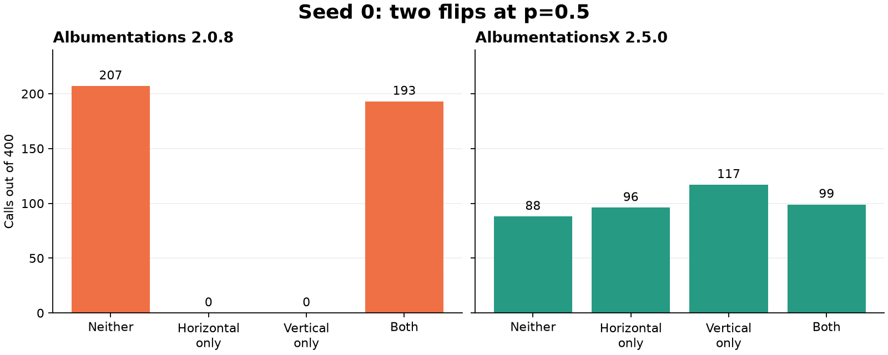

# Albumentations seeded flip check

A synthetic comparison of legacy **Albumentations 2.0.8** and maintained
**AlbumentationsX 2.5.0**, plus released Supervision, RF-DETR and Ultralytics
adapter checks. No model weights, images or external datasets are needed.

The legacy seeded pipeline samples horizontal and vertical flips together.
The maintained release produces all four orientations and repeats the entire
sequence exactly when reconstructed or reseeded. **The original defect is
fixed in AlbumentationsX 2.5.0; this repo does not claim a current X seeding bug.**



## Minimal case

```python
import albumentations as A
import numpy as np

transform = A.Compose(
    [A.HorizontalFlip(p=0.5), A.VerticalFlip(p=0.5)],
    seed=0,
)
image = np.arange(5 * 7 * 3, dtype=np.uint8).reshape(5, 7, 3)
outputs = [transform(image=image)["image"] for _ in range(400)]
```

`reproduce.py` classifies pixels against the four exact orientations, checks
complete-sequence reconstruction and reseeding, and records counts, phi
correlation and sequence SHA-256 for seeds 0, 1, 42 and 123. The asymmetric image
ensures that all orientations are distinguishable.

| Seed 0, 400 calls | Neither | Horizontal only | Vertical only | Both |
| --- | ---: | ---: | ---: | ---: |
| Albumentations 2.0.8 | 207 | 0 | 0 | 193 |
| AlbumentationsX 2.5.0 | 88 | 96 | 117 | 99 |

For the four seeds, legacy phi is 1; X phi ranges from about -0.063 to 0.029.
Each sequence repeats exactly. This finite smoke test demonstrates the old
correlation and rejects that defect in the current release. It does not prove
independence for every transform, seed, nested pipeline or DataLoader worker,
and it makes no training-speed or model-quality claim.

## Run with uv

Install [uv](https://docs.astral.sh/uv/getting-started/installation/) and use
Python 3.14 for the recorded environment. `uv.lock` pins dependencies. Both runs
use NumPy 2.4.6, OpenCV 5.0.0.93 and PyTorch 2.14.0; Albucore necessarily differs.
PyTorch is required by the X import graph even though the probe uses NumPy.
The Linux sources select matching CPU Torch and Torchvision wheels.

**Use separate environments.** Both distributions own the `albumentations`
module; co-installing them or switching an existing overlapping installation
can delete shared files. Do not use `--all-groups`.

```bash
export ALBUMENTATIONS_NO_TELEMETRY=1
export NO_ALBUMENTATIONS_UPDATE=1

UV_PROJECT_ENVIRONMENT="$HOME/data/albumentations-seed-check/legacy" \
  uv run --exact --frozen --only-group legacy python reproduce.py
UV_PROJECT_ENVIRONMENT="$HOME/data/albumentations-seed-check/current" \
  uv run --exact --frozen --only-group current python reproduce.py

UV_PROJECT_ENVIRONMENT="$HOME/data/albumentations-seed-check/legacy" \
  uv run --exact --frozen --only-group legacy python -m pytest -q
UV_PROJECT_ENVIRONMENT="$HOME/data/albumentations-seed-check/current" \
  uv run --exact --frozen --only-group current python -m pytest -q
```

The four RNG tests expect the demonstrated legacy behavior in the legacy group
and the corrected behavior in the current group. They fail on loss of sequence
repeatability or diversity. `reproduce.py --calls 4000 --seeds 0 1 42 123` provides
a larger diagnostic; assertions remain a smoke gate, not a statistical proof.

## Integration checks

Add `--only-group integration` to either version's commands:

```bash
UV_PROJECT_ENVIRONMENT="$HOME/data/albumentations-seed-check/current" \
  uv run --exact --frozen --only-group current --only-group integration \
  python integration_checks.py
UV_PROJECT_ENVIRONMENT="$HOME/data/albumentations-seed-check/current" \
  uv run --exact --frozen --only-group current --only-group integration \
  python -m pytest -q
```

The released adapters are Supervision 0.30.8, RF-DETR 1.11.2 and Ultralytics
8.4.174. These checks exercise public adapters using synthetic pixels, boxes and
labels, without constructing or training a detector.

| Route | Legacy 2.0.8 | X 2.5.0 |
| --- | --- | --- |
| Supervision boxes after horizontal flip | Pass | Pass, using `coord_format` |
| RF-DETR custom pixel transform | Pass | Pass |
| RF-DETR custom spatial transform | Pass | `BboxParams(format=...)` raises `TypeError` |
| Ultralytics default transform adapter | Pass | Pass |
| Ultralytics custom pixel transform | Pass | Pass |
| Ultralytics custom spatial transform | Pass | Initialization error is caught; adapter becomes `None` |

X renamed coordinate and transform arguments. It is **not an unchanged API
replacement for these released spatial adapters**. Their compatibility gap does
not establish an X defect: the removal of `format` was intentional, documented
in [upstream PR #147](https://github.com/albumentations-team/AlbumentationsX/pull/147).
Do not infer spatial compatibility from a successful import, or assume YOLO's
caught error means augmentation still ran. The integration test asserts both
the passing routes and the observed incompatibilities, so changes require review.

Full results are committed in `results/`. RNG tests pass in both groups;
with integration installed, **5 tests pass per group**. Recorded on Python
3.14.6 / macOS 27.0.1 arm64. No current-source patch or upstream PR is needed for
the original correlation case. Multi-worker training and task accuracy are
outside this reproducer's scope.
The same legacy/current matrix also
[passes on Linux CI](https://github.com/cdeil/albumentations-seed-check/actions/runs/38037903874).

## Licenses

This repo's original check code is MIT licensed; dependencies retain their own
licenses. Legacy Albumentations is MIT. X 2.5.0 is AGPL-3.0-only or commercially
licensed. See the [official FAQ](https://albumentations.ai/docs/faq/) for the
separate treatment of private training, distributed software and ordinary model
outputs. No upstream implementation is copied here.

## RF-DETR Kornia continuous box edges

`rfdetr_kornia_boxes.py` exercises the released trainer's real batch transfer
hook, without constructing a model or downloading weights. On a 10×6 synthetic
image, forced horizontal flips move pixels and masks correctly while shifting
continuous COCO box edges by one pixel. The full-frame box loses a column when
clipped: area 60 becomes 54. This is the RF-DETR adapter's coordinate convention,
not an AlbumentationsX defect.

```bash
UV_PROJECT_ENVIRONMENT="$HOME/data/albumentations-seed-check/current" \
  uv run --exact --frozen --only-group current --only-group integration \
  --only-group kornia python rfdetr_kornia_boxes.py
```

Both detection and segmentation cases assert the observed released defect.
Against a patched RF-DETR checkout, use its training environment and pass
`--expect fixed`; correct boxes have less than 1e-5 pixel error and retain area60.
The proposed correction applies the existing keypoint adapter's half-pixel
coordinate bridge to boxes for all model types. No training-quality claim is
made. The NumPy Albumentations path and this tensor Kornia path are separate
backends; installing X alone does not change this result.
